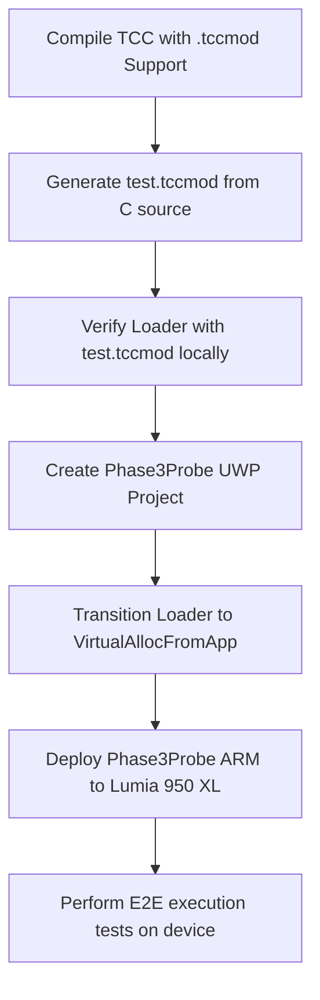

# Project Chronos Collapse - Project History, Status, and Roadmap

This document consolidates all historical updates, milestones, session summaries, checklists, and execution status reports for the Project Chronos Collapse.

---

## 1. Project Overview & Current Progress

```text
Overall Project Progress: 68% [████████████████░░░░]
```

### Phase-by-Phase Progress
- **Phase 1: Sandbox Probe** - **100% Complete** ✅
  - Verified JIT page permissions and Windows 10 Mobile app capability behaviors.
- **Phase 2: TinyCC ARM Backend** - **100% Complete** ✅
  - Configured compiler engine to generate Windows ARMNT compliant Thumb-2 instructions.
- **Phase 3: .tccmod Serializer & TCC Integration** - **83% Complete** ⏳
  - Core header definition, loader library, and serializer written and unit-tested.
  - Remaining: Compiling TinyCC with builder integration and verifying cross-compiler output.
- **Phase 4: Runtime Loader Integration** - **60% Complete** ⏳
  - SandboxProbe project setup, remote deployment, and basic JIT hooks ready.
  - Remaining: Port loader code to UWP, switch to `*FromApp` memory protection APIs, compile ARM builds, and test on Lumia 950 XL.
- **Phase 5: Python & Platform Integration** - **0% Complete** ⏳
  - Designing Python extensions dynamic injection backend and XAML App bridge.

---

## 2. Phase 3 & Session Milestones

### Core Accomplishments (Session 2026-07-26)
1. **Binary Format Design**:
   - Designed 80-byte header with strict packing (`#pragma pack(1)`) to avoid platform align discrepancies.
   - Defined Section, Symbol, Relocation, Import, and Export tables.
2. **Implementation**:
   - `tccmod.h`: Native module definitions and API declarations.
   - `tccmod_loader.c` (700+ lines): Handles memory allocation, symbol resolution, relocations, W^X layout protection, and Thumb LSB flag tagging.
   - `tccmod_builder.c` (400+ lines): Extracts sections, strings, relocations, and symbols from TCC state and outputs `.tccmod` images.
3. **Integration**:
   - Extended `libtcc.h` API with `TCC_OUTPUT_TCCMOD` (type 6).
   - Routed compilation outputs in `tccelf.c` directly to the serializer.
4. **Testing Suite**:
   - Created `check_layout.c` for structural validation.
   - Developed `create_test_module.c` to generate simulated Thumb-2 modules.
   - Wrote loader unit tests in `test_tccmod_loader.c` and `test_simple_loader.c`.
   - Achieved 100% test pass rate for basic structure and loader routines on Win32.

---

## 3. Critical Technical Decisions & Debt

### 3.1 Structural Alignment (80-Byte Header)
Initially computed as 64 bytes, the final tightly packed header requires 80 bytes due to the addition of precise offset and count tables (Import, Export, Symbol, String, Relocation, and Section). Using `#pragma pack(push, 1)` is mandatory to prevent padding offsets from varying across host compilers (e.g., MSVC vs. GCC).

### 3.2 Target ARM Thumb-2 State (LSB = 1)
Windows 10 Mobile exclusively compiles and runs user-mode user-space instructions in Thumb-2 state. In ARM state architecture, calling a function requires setting the least significant bit (LSB) of the branch target address to `1`. The loader dynamically checks module flags and automatically adjusts these pointer addresses when querying symbols or calling entry points.

### 3.3 Identified Debt & Future Improvements
1. **CRC32 Checksum Verification**: Currently, `tccmod_crc32` is implemented but the checksum field is set to `0` during serialization, bypassing verification checks. This needs to be active.
2. **Imports/Exports Table Incompleteness**: The structures exist, but the builder doesn't fully extract dynamic imports from standard host DLLs yet.
3. **Error Handling Verbosity**: Loader diagnostic prints are basic and should offer detailed structure dumps when format parsing fails.

---

## 4. Phase 4 Execution Roadmap

Once Phase 3's compilation test is completed, Phase 4 will execute the UWP deployment:



### Success Verification Checklist
- [ ] Compiler outputs valid `.tccmod` modules from standard C text source files.
- [ ] Loader compiles within a C++/CX UWP app container.
- [ ] Loader passes security policies by using UWP-compliant virtual memory management.
- [ ] Target functions execute successfully and return correct values on Lumia 950 XL.
